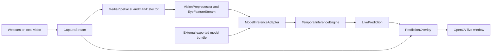

# Vigil v0.1 Architecture

## Scope and safety

Vigil v0.1 is a learning-focused driver-drowsiness prototype. It demonstrates
how video capture, facial landmarks, eye features, temporal inference, and a
live overlay can be connected through explicit interfaces. It is not a
production safety system, a medical device, or a substitute for attentive
driving.

## Live runtime

The runtime components are deliberately separated:

1. `CaptureStream` owns OpenCV capture lifecycle and attaches monotonic timing
   metadata to each frame.
2. `MediaPipeFaceLandmarkDetector` returns normalized face landmarks without
   deciding fatigue state.
3. `VisionPreprocessor` selects the eye landmarks and produces causal EAR,
   blink, and PERCLOS features.
4. `ModelInferenceAdapter` maps the runtime feature frame into the unlabeled
   `LiveInputFrame` contract.
5. `TemporalInferenceEngine` owns normalization, the 60-frame rolling window,
   15-frame prediction stride, and neural inference.
6. `PredictionOverlay` renders only a genuine canonical state and confidence.
   Before the first prediction, it displays `UNAVAILABLE` instead of inventing
   a state.

The public fatigue states remain exactly `ACTIVE`, `DROWSY`, and `SLEEPING`.
The colored on-frame state is the v0.1 visual alert; no audio or vehicle
control integration is implemented.

## Missing observations and temporal resets

Missing landmarks remain missing values. They are forwarded with
`landmarks_valid=False` and nullable EAR and eye-closure fields; they are never
converted to zero EAR or synthetic blinks. A cached display state may remain
visible between the model's stride steps, but it is cleared when the engine
reports a session reset, frame or timing discontinuity, invalid input, or an
inference error.

The model window resets when the session changes, frame indices are
discontinuous, or the interval between frames exceeds the bundle's configured
maximum. These resets prevent unrelated observations from being treated as one
continuous temporal sequence.

## Model-development pipeline

The model-development side owns the recording schema, baseline classifier,
temporal dataset, training, evaluation, and bundle export. The live runtime
consumes the published `LiveInputFrame` and `InferenceResult` contracts without
changing labels, feature meaning, window semantics, or preprocessing metadata.

## Artifact boundary

The repository contains bundle loading and validation code, but it does not
contain a trained checkpoint. Model bundles, datasets, recordings, benchmark
dumps, and generated demo media remain outside Git unless maintainers review
and approve a specific artifact. A usable live demo therefore requires an
external exported `.pt` bundle with its fitted normalizer and preprocessing
metadata.

## Module map

| Area | Main modules | Responsibility |
| --- | --- | --- |
| Capture | `vigil.runtime.capture` | Webcam/video access and frame timing |
| Landmarks | `vigil.runtime.landmarks` | MediaPipe lifecycle and face/eye points |
| Features | `vigil.runtime.eye_features` | EAR, blink tracking, and PERCLOS |
| Preprocessing | `vigil.runtime.preprocessing` | Timed landmark-to-feature boundary |
| Runtime inference | `vigil.runtime.inference` | Model adapter and safe display state |
| Composition | `vigil.runtime.live_pipeline` | Per-frame preprocessing and inference |
| Presentation | `vigil.runtime.overlay` | State and confidence overlay |
| Model development | `vigil.ml` | Data, baseline, temporal model, export, evaluation |
| Benchmarking | `vigil.benchmark` | Bounded, measured vision performance runs |

## Current limitations

- No real-world accuracy, FPS, or latency result is published yet.
- No trained model bundle or recorded driver dataset is distributed.
- Fatigue states depend on the supplied model and its approved preprocessing
  configuration; v0.1 does not calibrate thresholds automatically.
- The prototype assumes at most one visible driver face.
- Camera availability, lighting, eyewear, pose, occlusion, and hardware can
  materially affect landmark quality.
- The live UI is a desktop OpenCV window and has no production alerting,
  telemetry, persistence, or vehicle integration.
